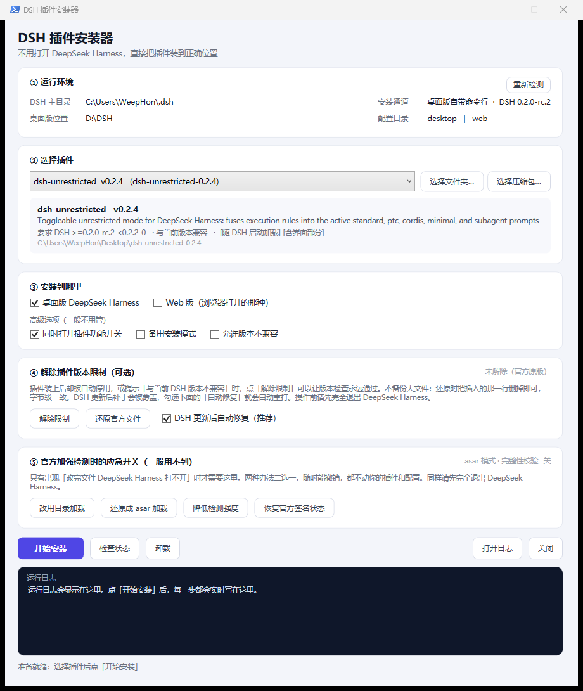

# DSH 插件安装器

**不用打开 DeepSeek Harness，就能把插件装到正确的位置。**

双击 `DSH插件安装器.exe` → 选插件 → 点「开始安装」，完事。装好后再启动 DSH，插件就在「插件」页面里等着你。



---

## 它解决什么问题

DSH 的插件不是"把文件夹拷进去"就生效，它要求四件事同时成立：

| 位置 | 作用 | 少了会怎样 |
|---|---|---|
| `~/.dsh/profiles/<配置>/package.json` 的 `dependencies` | 记录"我依赖这个插件" | DSH 不知道有这个插件 |
| 同一文件里的 `dsh.profile.bundles` | 记录"启动时加载它" | 装上了但不加载 |
| `~/.dsh/profiles/<配置>/node_modules/` | 插件本体 | 加载时报找不到模块 |
| `~/.dsh/profiles/<配置>/cordis.patch.yml` 的 `config.enabled` | 功能开关 | 插件在，但功能没开 |

手动改这四处很容易漏。本工具把整条链路做对，而且**调用 DSH 自带的官方命令**（`dsh plugin add`），结果和在 DSH 界面里点安装完全一致，不是硬改文件。

---

## 两种用法

### 1. 单文件 exe（推荐）

下载 `DSH插件安装器.exe`，双击即可。不需要装 PowerShell 模块、不需要联网、不需要管理员权限。

- 首次运行会把自己解压到 `%LOCALAPPDATA%\DSH-Plugin-Installer\<构建号>\`（约 350 KB）
- 那个位置写不进去时，自动改放 `%TEMP%` 或程序旁边的 `_run_<构建号>\`，功能不受影响
- 想做成绿色便携版：设环境变量 `DSH_INSTALLER_HOME=D:\某目录`
- 出问题会在**程序所在目录**或 `%TEMP%` 留一个 `dsh-installer-error.log`

### 2. 脚本版

```bat
开始安装.bat          :: 图形界面
命令行模式.bat         :: 命令行
```

脚本版和 exe 功能完全一致，适合想改代码、或杀毒软件对未签名 exe 敏感的情况。

---

## 命令行

```bat
DSH插件安装器.exe list
DSH插件安装器.exe status
DSH插件安装器.exe install    -PluginPath "C:\插件目录" -Profiles desktop
DSH插件安装器.exe uninstall  -PluginName dsh-unrestricted -Profiles desktop
DSH插件安装器.exe unlock               :: 解除插件版本限制
DSH插件安装器.exe restore-official     :: 还原官方文件
DSH插件安装器.exe autoheal             :: DSH 更新后自动修复
DSH插件安装器.exe dir-on / dir-off     :: 应急：改用目录加载 / 还原成 asar
DSH插件安装器.exe fuse-off / fuse-restore  :: 应急：降低检测强度 / 恢复官方签名状态
```

常用开关：`-Profiles desktop,web` 指定装到哪个配置；`-EnableConfig` 顺便打开功能开关；`-ManualMode` 走备用安装通道（不依赖 pnpm）；`-ForceVersion` 允许版本不兼容；`-Quiet` 去掉"按任意键关闭"。

---

## 进阶：解除插件版本限制

DSH 会检查插件的 `peerDependencies["@deepseek-ai/dsh"]`，版本对不上就把插件**静默停用**。这种情况下界面里第 ④ 张卡片可以：

- **解除限制**：在 `app.asar` 内的 `dsh-app-boot/lib/index.js` 里，给判定函数插一行 `return void 0;`（放行）
- **还原官方文件**：把插入的那一行删掉，回到官方原样（不备份 100 MB 大文件，删一行即可，逐字节一致）

实现上是**自适应**的：函数改名、换文件、只剩一个提示函数，都能靠内容搜索重新定位（扫描 12967 个文件约 0.9 秒）。改完先在沙盒里跑一遍行为自检，确认真的放行了才替换，否则放弃并保留原文件。

勾选「DSH 更新后自动修复」，每次启动安装器会检查补丁是否被官方更新覆盖，需要时自动重打。

## 进阶：应急开关

万一以后 DSH 加强检测（例如打开 `EnableEmbeddedAsarIntegrityValidation`，改 asar 就会起不来），第 ⑤ 张卡片提供两条预案：

| 按钮 | 做什么 | 代价 |
|---|---|---|
| 改用目录加载 | 把 `app.asar` 摊开成 `resources\app\` 目录来加载，asar 校验无处对比 | 多占约 360 MB 磁盘 |
| 降低检测强度 | 改 `DeepSeek Harness.exe` 里的 fuse 开关字节 | **exe 的 Authenticode 签名失效**，Windows 可能提示未知发布者 |

两个都可以一键还原（改过的开关有记录，恢复后 exe 与原始逐字节一致）。

---

## 工作原理

1. 找插件：`plugins\`、桌面、下载里名字带 dsh/plugin 的文件夹，或手动选文件夹 / 压缩包
2. 复制插件到 `~/.dsh/local-plugins/<名字>-<版本>`，让源文件夹可以删掉
3. 改动前备份 profile 的 `package.json` / `cordis.patch.yml` 到 `~/.dsh/plugin-installer-backups/<时间戳>/`
4. 调官方 CLI：`dsh plugin --profile <p> add file:<绝对路径>`（自动维护 `dependencies`、`bundles`、`node_modules`）
5. 找不到官方 CLI 时走"备用安装模式"：自己写 `package.json` + `bundles`，用 Junction 指向 `local-plugins`
6. 可选：往 `cordis.patch.yml` 写带标记的功能开关，卸载时按标记精确移除

所有操作都会写日志（界面实时滚动，或 `logs\` 下的文件）。

---

## 构建 exe

```powershell
powershell -ExecutionPolicy Bypass -File build\build-exe.ps1
```

用 .NET Framework 自带的 `csc.exe` 编译 `build\Program.cs`，把 14 个文件作为资源嵌入，输出 `dist\DSH插件安装器.exe`（约 350 KB，无需联网、无需安装任何东西）。

`build\make-icon.ps1` 用 `System.Drawing` 生成图标 `build\app.ico`。

---

## 目录结构

```
DSH-Plugin-Installer.ps1   GUI（WPF），双击入口
cli-mode.ps1               命令行入口
开始安装.bat / 命令行模式.bat
core\dsh-plugin-core.ps1   安装 / 卸载 / 状态检测引擎
core\dsh-unlock-core.ps1   解除版本限制（asar 读写 + 行为自检 + 自动修复）
core\dsh-unlock-dir.ps1    目录加载模式下的同一套补丁逻辑
core\dsh-fallback-core.ps1 应急开关：fuse 改写 / 目录模式切换
core\unlock-targets.json   补丁点配置（可自己加正则，适应官方改动）
tools\dsh-asar.cjs         纯 Node 的 asar 读写工具（list/extract/extractall/patch/find/has/verify/fuses）
build\                     exe 构建：Program.cs / build-exe.ps1 / make-icon.ps1 / app.ico
使用说明.md                 面向普通用户的完整说明
```

---

## 常见问题

**杀毒软件报毒 / 直接把 bat 删了？**
未签名的新程序容易误报。把整个目录加进信任区，或用脚本版。源码全在这里，可以自己审。

**提示找不到 DSH？**
安装器会自动探测 `D:\DSH`、`%LOCALAPPDATA%\Programs` 和注册表；装在奇怪的位置时手动指定即可。

**装完 DSH 里看不到插件？**
重启 DSH，然后到「插件」页面确认它处于开启状态；再到插件详情里确认功能开关（`config.enabled`）也开了。

**解除限制后 DSH 起不来？**
点「还原官方文件」。还原是删掉插入的那一行，逐字节回到官方原样。

---

## 免责声明

本工具通过调用 DSH 官方 CLI 完成安装，不修改 DSH 源码。进阶功能（解除版本限制、应急开关）会修改 DSH 安装目录内的文件，**属于个人环境下的兼容性调整**，请自行评估风险：可能违反软件许可协议、可能随官方更新失效、也可能导致程序无法启动（提供一键还原）。使用即表示你了解并接受这些后果。

## License

MIT © 2025
